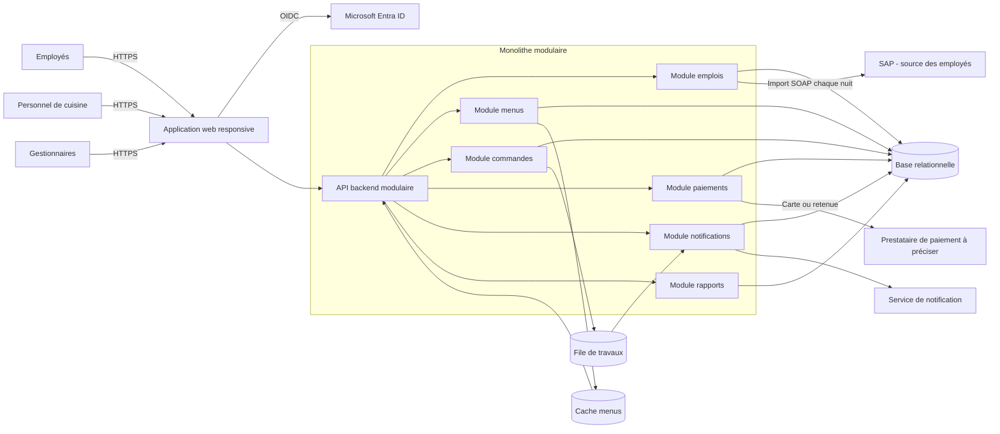

# Architecture cible — Cantine+

## Décision de conception

Pour le pilote Laval et les déploiements suivants, Cantine+ utilise un
**monolithe modulaire déployable** : un seul backend web avec des modules métier
isolés par des interfaces internes. Cette option convient à une équipe de quatre
développeurs, réduit les opérations et permet un lancement en trois sprints.

Les composants restent remplaçables ou extractibles vers des services séparés
si les besoins de charge ou d'organisation l'exigent ultérieurement.

## Diagramme

## Tableau des composants

| Composant | Responsabilité | Données ou dépendances principales | Exigence architecturale |
|---|---|---|---|
| Application web responsive | Afficher les menus, précommander, annuler, payer, retirer par QR et permettre les tableaux cuisine et gestion | API HTTP, Microsoft Entra ID | Adapter à mobile, tablette et bureau; éviter les appels externes synchrones |
| API backend modulaire | Valider les requêtes, appliquer l'autorisation et coordonner les modules | HTTPS, base relationnelle | Transactions courtes; frontières strictes entre modules |
| Module emplois | Synchroniser les employés et déterminer le statut permanent ou contractuel | SAP, Entra ID | SAP reste la source de vérité; maintenir horodatage et résultat du dernier import |
| Module menus | Gérer les plats, prix, allergènes, calories et versions du menu | Base relationnelle, cache | Revue obligatoire des allergènes; les informations affichées doivent être versions |
| Module commandes | Précommande jusqu'à 10 h 30, créneau de 15 minutes, annulation et code QR | Base relationnelle | Annulation idempotente; limite de capacité par créneau; historique préservé |
| Module paiements | Carte ou retenue sur paie selon l'admissibilité | Prestataire de paiement; module emplois | Aucune confiance aveugle dans les callbacks; journaliser les décisions et remboursements |
| Module notifications | Signaler que la commande est prête | File de travaux, service de courrier ou push | Livrer au mieux avec relance, sans bloquer la transaction de commande |
| Module rapports | Produire les ventes, le gaspillage et les plats populaires | Base relationnelle | Agrégations périodiques pour ne pas impacter les écrans en pic |
| Base relationnelle | Assurer la persistance transactionnelle des modules | Sauvegardes et chiffrement | Contraintes référentielles; données personnelles limitées à l'usage opérationnel |
| Cache menus | Accélérer les consultations du menu à 8 h 30 | Menu du jour et du site | Invalidation lors de toute modification d'un plat ou de ses allergènes |
| Microsoft Entra ID | Authentifier les employés avec le SSO | Jetons OIDC | Attribution des rôles de lecture, cuisine, gestion et administration |
| SAP | Fournir les employés, statuts et informations nécessaires aux retenues | Interface SOAP, lot nocturne | Import isolé, rejouable et journalisé une fois par nuit |
| Prestataire de paiement | Autoriser les paiements par carte ou garantir les remboursements | API externe à définir | Distinguer le délai d'autorisation de l'état final; éviter les doubles captures |

## Pic de charge

Le pic porte principalement sur la création de 1 500 commandes entre
9 h 45 et 10 h 30. L'application utilise des écritures relationnelles courtes,
une capacité vérifiée par créneau et un traitement asynchrone des notifications.
Les consultations autour de 8 h 30 sont servies depuis le cache de menus.

Le paiement doit être préparé avant le pic ou traité au moyen d'une file
asynchrone lorsque le prestataire le permet, afin que la disponibilité du
prestataire n'affecte pas directement l'affichage du menu. Les objectifs
exactes de latence restent à valider.

## Allergènes

Chaque plat possède une liste d'allergènes versionnée. Une commande conserve
les informations d'allergènes affichées au moment de la commande afin de garder
une preuve cohérente avec l'état du menu. Les modifications sont autorisées
selon les rôles Entra ID et doivent produire une piste d'audit.
